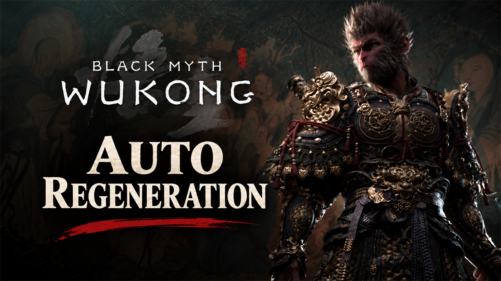

# Auto Regeneration

Health and mana recover 1.25% of their maximum every second, focus and vessel and transformation energy 5 per second. Always on with any gourd.

## What it does

A permanent regeneration buff that works every second:

| Resource | Per second | From empty to full |
|---|---|---|
| Health | 1.25% of your maximum health | 80 seconds |
| Mana | 1.25% of your maximum mana | 80 seconds |
| Focus | +5 | |
| Vessel energy | +5 | |
| Transformation energy | +5 | |

- The amounts for health and mana grow with your character: at the start (300 health, 200 mana) that is 3.75 health
  and 2.5 mana per second.
- Stamina recovers as in the game.
- The buff comes with the gourd, and a gourd is always equipped, so it is always on. Every gourd keeps its own effect.

## Screenshots

## How to install

1. Download the zip of the latest release on GitHub (`wukong_autoregeneration_<version>.zip`).
2. Open the game folder `b1\Content\Paks\`. If it has no folder `~mods`, create it.
3. Unpack `wukong_autoregeneration_P.pak` from the zip into `b1\Content\Paks\~mods\`.
4. Add the launch option `-fileopenlog`: in Steam, right-click the game, Properties, General, Launch Options.
   Without it the game does not load mods from `~mods`.
5. Start the game.

To update the mod, replace the file with the one of the new release. To remove it, delete the file; the launch option
can stay.

## How to use

Nothing to do: the mod works as soon as you load a game.

## Compatibility

- Game version: 1.0.21 (`1.0.21.23831`).
- The mod replaces three game tables: `EquipDesc` (all equipment), `TalentSDesc` (all talents) and
  `FUStBuffDesc-Talent` (the talent buffs). A mod that replaces one of them conflicts with this one; only one of them
  works.
- A game update that changes these tables needs a new build of the mod. Until then, the mod puts the older versions of
  the tables back; remove the mod after a game update until a new version is out.

## Known issues

None yet.

## How to build

Anyone can build this mod from its source code and check that the download matches it.

1. Install Python 3 (https://www.python.org; no extra package needed). Windows PowerShell 5.1 is part of Windows.
2. Build it: `powershell -ExecutionPolicy Bypass -File .\build.ps1`
3. Find the file: `dist\wukong_autoregeneration_P.pak`. `README.md` has the details.

## Credits

Made by Kintaro. MIT license: you may use, change and share this mod. Black Myth: Wukong and its files belong to
their makers; the mod changes only what is listed above.
